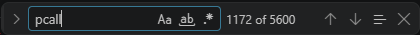
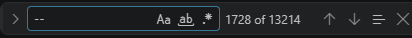
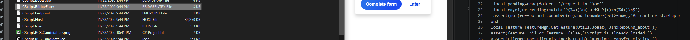

# CScript — The €10 Experience, Now Free

Imagine charging €10 for this.

Corpen spent his time trying to knock off K-Script's concepts, only for us to get a working version of CScript in less than five minutes.

So here it is, free of charge.

## The absolute state of CScript

**5,600 matches for `pcall`.**

Did the AI have a nervous breakdown halfway through generating this?

Apparently, wrapping everything in a `pcall` is easier than understanding why something might throw an error in the first place. At this rate, we're surprised the entire script isn't one giant `pcall`.

This is one of the red flags behind our assessment that CScript is heavily AI-generated. Apparently, the €10 price tag doesn't include an actual code review.

## Security, according to Corpen

Trying to replicate K-Script's concepts is one thing. Understanding the technology behind them is apparently another.

The CScript startup check shown below looks for a feature named `JinxRebound_about`. But Hey according to Corpen nothing here is Skidded from anyone else, right?????

We're fairly convinced that you could hand Corpen an entire cryptographically secure system, complete with documentation and implementation instructions, and he'd somehow manage to turn it into a security vulnerability.

Perhaps another 5,600 `pcall` calls would help.

For all the effort spent trying to imitate K-Script, you'd expect something that takes longer than five minutes for us to get working.

## Download

The working version is available in this repository for free.

[Download CScript_standalone.lua](./CScript_standalone.lua?raw=true)

No payment required.

Spend your €10 on a pizza. It'll probably be a better investment.

*This repository is not affiliated with Corpen or the official CScript project.*
